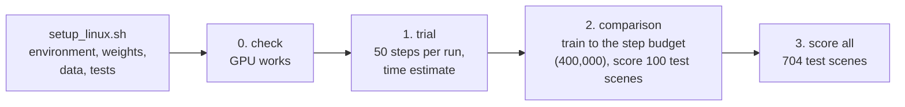

# Running the comparison on a GPU server

This page takes a fresh Linux machine with an NVIDIA GPU, such as a GH200
cloud instance, to a finished comparison report. You type two commands; the
second runs for days (see "Choosing the step budget") and needs no one to
step in.

The scripts were written for a GH200 (ARM processor, Hopper GPU) but use
nothing specific to it. They were tried on a Windows machine with an RTX
4090, not on a GH200 itself.

## What runs, in order



| Step | What it does | On an RTX 4090 |
|---|---|---|
| 0 | Checks that PyTorch can use the GPU; prints what the machine gives the runs | seconds |
| 1 | A 50-step trial of every run with every stage, in `runs/trial`, so that a problem with the machine shows up early; then, once, an estimate of how long the rest takes on this machine (see "Choosing the step budget") | 15 min |
| 2 | The comparison: training every run to the step budget (400,000 unless you choose another), scores on the first 100 test scenes, speed | 46 h |
| 3 | Scores on all 704 test scenes, 10 views each | 11 h |

About 57 hours in all: the estimate's figures on an RTX 4090 in full
float32 (`experiment.float32_matmul_precision=highest`). A GH200
should be faster: `float32_matmul_precision: high` in `configs/base.yaml`
lets its tensor cores compute the matrix products in TensorFloat-32. (On the
RTX 4090 itself, a short test with it rendered 20 to 35% more frames per
second.)

Each step skips what it has already done. If the machine stops, run the
same command again and it carries on.

## The training recipe

Every run, the baselines included, trains with pixelNeRF's recipe for
ShapeNet-SRN (its appendix B.2), set in `configs/base.yaml`: 400,000 steps
of 4 scenes and 128 rays each, the learning rate 1e-4 for every parameter,
two source views and rays from the box around the car for the first 300,000
steps, then one or two source views and rays from the whole image. No model
is tuned. The comparison is of the models as published: the training is the
same for all, but each pretrained encoder comes with its own pretraining
(ConvNeXt V2 with FCMAE, Hiera with MAE, on different schedules), so a
difference between encoders is not the architecture's alone.

Where it differs from pixelNeRF, the same way for every model: the learning
rate rises over the first 2,000 steps and then falls tenfold over the
budget (pixelNeRF keeps 1e-4 throughout); each step loads 8 views per scene
(pixelNeRF draws rays from all 50); and the renderer takes 64 + 32 samples
per ray (pixelNeRF 64 + 16 + 16 around a depth guess); and rays pass
through pixel centres at i + 0.5, half a pixel from pixelNeRF's
(`configs/data/srn_cars.yaml`). TransNeRF published
no results on SRN cars and was built for 8 to 12 source views, so it is
trained here like every other model, not compared with its paper.

## Choosing the step budget

Each run trains 400,000 steps, pixelNeRF's number. After its trial
(step 1), `run_comparison.sh` times a few training steps and scored views
of every run on this machine, and writes how long the rest would take, for
a few budgets, into `runs/time_estimate.txt`. It prints that file every time
it starts. On the RTX 4090, with the settings of `configs/base.yaml` but in
full float32:

```text
Hours from the start of training until:
  steps per run | trained, scored on 100 test scenes | final report
        100,000 |                               12.7 |         24.0
        200,000 |                               23.7 |         35.0
        300,000 |                               34.7 |         46.0
        400,000 |                               45.7 |         57.0
```

To use another budget, stop the script (`Ctrl-c`) and start it again with
the number of steps after the output folder:

```bash
bash scripts/run_comparison.sh runs 200000
```

- **Until when.** The budget can change until the first run saves its
  first checkpoint, 5,000 steps in (`training.checkpoint_every`). The
  learning-rate schedule follows the budget, so after that the script
  refuses another budget in that output folder; another budget then needs a
  new output folder, where everything trains from the start. A run stopped
  before its first checkpoint starts again from step 0.
- **What it changes.** For every run: `training.num_steps`,
  `optimization.decay_steps` (the learning rate falls tenfold over the
  budget) and `training.first_phase_steps` (three quarters of the budget,
  as pixelNeRF's 300,000 of 400,000). The budget is kept in
  `runs/steps_per_run`, so the same command without a number carries on
  with it after a restart.
- **How far to trust it.** It times the training steps at the start of
  training, which always take two source views, where the later steps take
  one or two, so it errs on the long side. It also times the checks of the
  data: the training data at every checkpoint save (it looks at all 248,000
  files), and both splits read in full once in each of steps 2 and 3. On a
  slow network volume these can add hours. It leaves out
  starting each run and writing the checkpoint files. On a shared GPU it
  only knows the sharing at the time it ran. Leave some spare time: if the
  end comes too early, the scores on the first 100 test scenes are already
  there (see "Not enough time left" below).
- **Afterwards.** With another budget, record it in the repository (the
  script says so when it finishes): `training.num_steps`,
  `training.first_phase_steps` and `optimization.decay_steps` in the
  `common` block of `configs/suites/proposal_comparison.yaml`.

The estimate can also be made by hand, for any budgets, once the setup is
done (one line; add `--set` options as the script does):

```bash
scene-recon estimate-time --config configs/suites/proposal_comparison.yaml --steps 200000 400000 --first-scenes 100 --set experiment.device=cuda
```

## On a Run:ai cluster

On a Run:ai cluster the machine is a container holding a share of a GPU.
Nothing in the configs has to change for that, but these things matter:

- **Storage.** Clone the repository onto a persistent volume, one that
  outlives the workload (in Run:ai, a data source such as a persistent
  volume claim). The environment `.venv`, the data, the results and the
  pretrained weights the runs download (`weights/`) all live inside the
  repository. Everything else is lost, with every checkpoint on it: the
  container's own disk when the container restarts, and a temporary volume
  (`emptyDir`, mounted, say, at `/workspace`) when Run:ai replaces the
  whole pod. Both scripts warn if the repository is on the container's own
  disk, but they cannot recognise a temporary volume, so check where your
  workload mounts what before you start. If the container image sets
  `HF_HUB_CACHE` or `TORCH_HOME`, those folders must be persistent too:
  step 0 of `run_comparison.sh` prints where the downloaded weights go.
- **Same software after a restart.** Start the workload again with the
  same container image and the volume at the same path: `.venv` uses the
  image's Python, and the report marks each comparison whose evaluations
  were scored with different software.
- **The GPU share.** A share of 0.99 gets 99% of the GPU's memory, about
  95 GB of a 96 GB GH200. On an RTX 4090 the runs needed at most 22 GB
  (PyTorch's peak, while training hiera_nerf); a GH200 should need about
  the same. A share divides the memory, but not necessarily the computing
  time: depending on how the cluster is set up, another workload placed in
  the remaining 1% takes turns on the GPU while both compute. Training then
  slows down, and the training hours and frame rates that the report
  compares between models are off for the runs measured meanwhile. Ask the
  cluster's administrators whether anything else can be scheduled on that
  GPU. Settle the share before you start and keep it until the end: the
  speeds of a comparison are only comparable when every run was measured
  with the same share. If it does change, delete every run's
  `profile.json` so that all are measured again the same way; the
  training hours stay a mix. The copy of the report on the first 100 test
  scenes keeps the speeds measured before the change; its quality scores
  stay valid.
- **Shared memory.** The 4 processes that load batches pass them through
  `/dev/shm`: about 34 MB of it on the GH200, less than the 64 MB a
  container usually gets by default. Training checks this before it starts
  and, if too little is free, stops and says what to do. That leaves little
  to spare, so turn on large shared memory when you submit the workload
  (`--large-shm`, or "Increase shared memory size" in its settings).
- **Processors and memory.** On the RTX 4090 machine, 4 loading processes
  had a batch ready every 6 ms, against 240 to 310 ms per training step,
  so more processors would not train faster there; 8 should be plenty, and
  48 do no harm. The workload's main memory has a limit of its own; leave
  it generous. Step 0 of `run_comparison.sh` prints the GPU memory,
  processors and shared memory the container has.
- **Restarts.** Run:ai may stop a workload, for example one that runs
  beyond its project's quota. Once it runs again, start the same command:
  finished work is kept and training continues from its last checkpoint
  (saved every 5,000 steps).

How long the whole comparison takes on this machine is in
`runs/time_estimate.txt` after step 1 (see "Choosing the step budget").
Training then confirms it: `runs/proposal_comparison/suite.log` logs every
100 steps with the time. If the first run trains much slower than the
estimate said, another workload may be sharing the GPU, or loading from the
volume is slow.

If the container has no `tmux`, start the comparison in the background
instead; its output is in `runs/run_comparison.log`:

```bash
nohup bash scripts/run_comparison.sh runs > /dev/null 2>&1 &
```

Ctrl-c in `tail -f runs/run_comparison.log` stops only `tail`, not the
comparison. To stop it (for example to choose another step budget), run
`pkill -f run_comparison.sh; pkill -f scene-recon`, and start again once
`pgrep -f scene-recon` prints nothing. The script refuses to start while
another launch, or a training process it started, still uses the folder.

## 1. Prepare the machine (about 20 minutes)

```bash
git clone https://github.com/mp2591/3d-scene-reconstruction.git
cd 3d-scene-reconstruction
bash scripts/setup_linux.sh
```

The script creates `.venv`, installs the package, checks that PyTorch sees
the GPU, downloads the Hiera-T weights and ShapeNet-SRN Cars, checks that
the data has all 2,458 / 352 / 704 scenes with every image and pose, and runs
the tests. It stops with an explanation if something is missing, and can be
run again after an interruption: finished steps are skipped. Two things it
may ask for:

- **`python3-venv`**: `sudo apt install python3-venv`, then run it again.
- **No GPU in PyTorch**: the driver is older than the CUDA version of the
  PyTorch it installed. The message gives the command that installs a
  PyTorch for an older CUDA.

If Google Drive refuses the dataset download (it limits how often a file
can be downloaded), copy the dataset from a machine that has it, then run the
script again:

```bash
rsync -a data/srn_cars/ <user>@<server>:3d-scene-reconstruction/data/srn_cars/
```

### Setting up by hand (conda or another environment)

`setup_linux.sh` does all of this; these are the same steps for an
environment you make yourself. From the repository folder:

1. **Packages.** In the activated environment (for conda:
   `conda create -n scene-recon python=3.11 -y`, `conda activate scene-recon`):

   ```bash
   pip install -r requirements.txt
   python -c "import torch; print(torch.cuda.is_available())"   # must print True
   ```

   If it prints False:
   `pip install --force-reinstall torch torchvision --index-url https://download.pytorch.org/whl/cu128`.
2. **Hiera-T weights** (661 MB), to `weights/hiera_tiny_224_mae_in1k.pth`:

   ```bash
   mkdir -p weights
   curl --fail -L -o weights/hiera_tiny_224_mae_in1k.pth https://dl.fbaipublicfiles.com/hiera/mae_hiera_tiny_224.pth
   ```

   The ConvNeXt V2 weights (Hugging Face) and the VGG16 of LPIPS download
   themselves on first use.
3. **ShapeNet-SRN Cars** (2.4 GB, the copy pixelNeRF published), unpacked
   so that `data/srn_cars/cars_train`, `data/srn_cars/cars_val` and
   `data/srn_cars/cars_test` exist (the paths in `configs/data/srn_cars.yaml`):

   ```bash
   mkdir -p data
   curl --fail -L -o data/srn_cars.zip "https://drive.usercontent.google.com/download?id=19yDsEJjx9zNpOKz9o6AaK-E8ED6taJWU&export=download&confirm=t"
   python -m zipfile -e data/srn_cars.zip data/srn_cars
   ls data/srn_cars/cars_train | wc -l   # 2458 scenes; cars_val 352, cars_test 704
   ```

   If the file is a web page instead of a ZIP archive, Google Drive refused
   the download: try later, or copy `data/srn_cars/` from another machine.
4. **Tests** (a few minutes): `python -m pytest -q`.

`run_comparison.sh` needs the `.venv` that `setup_linux.sh` makes. In an
environment of your own, either run `bash scripts/setup_linux.sh` with that
environment active (it builds `.venv` on its Python), or run the steps of
the comparison by hand, each on one line, from the repository folder:

```bash
C=configs/suites/proposal_comparison.yaml; S="experiment.output_dir=runs experiment.device=cuda"
scene-recon run-suite --config $C --set $S evaluation.num_scenes=100   # 2. train, score 100 test scenes
scene-recon run-suite --config $C --set $S                             # 3. score every test scene
```

For another step budget N, add `training.num_steps=N
optimization.decay_steps=N training.first_phase_steps=M` to both `--set`,
with M three quarters of N. Every command carries on where it stopped when
run again. Before step 3, copy `runs/proposal_comparison/summary.md` aside:
it is the report on the first 100 test scenes, which step 3 replaces.

## 2. Start the comparison

Start it inside `tmux`, so that it keeps running when the SSH connection
drops (without `tmux`, see "On a Run:ai cluster" above):

```bash
tmux new -s comparison
bash scripts/run_comparison.sh runs
```

Leave tmux with `Ctrl-b` then `d`; come back with `tmux attach -t comparison`.
Everything the script prints is also written to `runs/run_comparison.log`.
It first checks that PyTorch can use the GPU, and tells every run to use it,
so no run can fall back to the processor unnoticed. About 15 minutes in, it
prints how long the rest will take; that is the moment to choose another
step budget (see "Choosing the step budget").

## Watching it

- Progress: `tail -f runs/proposal_comparison/suite.log`.
- Validation scores one source view, but training takes two until three
  quarters of the budget (the first phase). The validation PSNR therefore
  looks low for most of a run and rises once one-view steps begin; that is
  expected, not a failing run.
- Training curves: on your own computer, `ssh -L 6006:localhost:6006 <user>@<server>`,
  then on the server `.venv/bin/tensorboard --logdir runs --port 6006`, and
  open http://localhost:6006.
- The GPU: `nvidia-smi`.

## Results

| File | Contents |
|---|---|
| `runs/proposal_comparison/summary.md` | The final report: quality, cost, paired comparisons, figures |
| `runs/proposal_comparison_first_100_test_scenes/summary.md` | The same after step 2, on the first 100 test scenes |

A cloud instance's disk is usually deleted with the instance. Copy the
results to your own computer before shutting it down, for example without
the checkpoints:

```bash
rsync -a --exclude checkpoints <user>@<server>:3d-scene-reconstruction/runs/ gpu-server-runs/
```

## If something goes wrong

- **A test fails during setup.** The tests ran on Windows and on Linux
  with Intel or AMD processors, not on an ARM processor such as the
  GH200's. If a failure is about this machine rather than the code, the
  comparison can still be started: step 1 trains, scores and times every
  run on this machine for a few steps first. The tests are setup's last
  step, so everything else is in place by then.
- **The script stopped with an error.** The last lines name the problem;
  the suite logs (`runs/*/suite.log`) have the details. Fix it and run the
  same command again: finished work is kept.
- **Not enough time left.** Every run has scores on 100 test scenes after
  step 2. Step 3 may be stopped (`Ctrl-c`) and those used instead; they are
  kept in `runs/proposal_comparison_first_100_test_scenes/`. Once that folder
  exists, step 2 is not run again; after changing the comparison (another
  model, another seed), delete it to have step 2 run again.
- **Time to spare at the end.** The step budget is best chosen at the
  start (see "Choosing the step budget"). After step 3, more training steps
  can still be asked for: run steps 2 and 3 again by hand with
  `--set optimization.decay_steps=<budget> training.first_phase_steps=<three quarters of it> training.num_steps=<more steps>`,
  where `<budget>` is the number in `runs/steps_per_run`. Every run
  continues; the learning rate keeps falling past
  `optimization.decay_steps`. Keep running steps 2 and 3 by hand with the
  same `--set` from then on.
- **Running the steps by hand.** The commands are at the top of
  `configs/suites/proposal_comparison.yaml`.
- **A folder trained with the old recipe.** Runs trained before the recipe
  changed (for example 100,000 steps with 1,024 rays per step) cannot be
  continued with it: training refuses, as the settings differ. Start in a
  new output folder.
