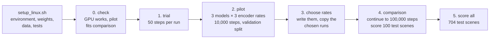

# Running the comparison on a GPU server

This page takes a fresh Linux machine with an NVIDIA GPU, such as a GH200
cloud instance, to a finished comparison report. You type two commands; the
second runs for up to two days and needs no one to step in.

The scripts were written for a GH200 (ARM processor, Hopper GPU) but use
nothing specific to it. They were tried on a Windows machine with an RTX
4090, not on a GH200 itself.

## What runs, in order



| Step | What it does | On an RTX 4090 |
|---|---|---|
| 0 | Checks that PyTorch can use the GPU, and that every pilot run trains exactly like a comparison run apart from the encoder's learning rate | seconds |
| 1 | A 50-step trial of every comparison run with every stage, in `runs/trial`, so that a problem with the machine shows up early | 10 min |
| 2 | The learning-rate pilot: each model with encoder rates 1e-5, 3e-5 and 1e-4 for 10,000 steps, scored on 100 validation scenes | 7.5 h |
| 3 | `scene-recon choose-encoder-rates`: per model, the lowest rate within 0.1 dB PSNR of the best; writes it into `configs/suites/proposal_comparison.yaml` and copies that pilot run into the comparison, which continues it | minutes |
| 4 | The comparison: training from step 10,000 to 100,000, scores on the first 100 test scenes, speed | 21.5 h |
| 5 | Scores on all 704 test scenes, 10 views each | 12.5 h |

About 42 hours in all on an RTX 4090, timed in full float32. A GH200
should be faster: `float32_matmul_precision: high` in `configs/base.yaml`
lets its tensor cores compute the matrix products in TensorFloat-32. (On the
RTX 4090 itself, a short test with it rendered 20 to 35% more frames per
second.)

Each step skips what it has already done. If the machine stops, run the
same command again and it carries on.

## 1. Prepare the machine (about 20 minutes)

```bash
git clone https://github.com/mp2591/3d-scene-reconstruction.git
cd 3d-scene-reconstruction
bash scripts/setup_linux.sh
```

The script creates `.venv`, installs the package, checks that PyTorch sees
the GPU, downloads the Hiera-T weights and ShapeNet-SRN Cars, checks that
the data has all 2,458 / 352 / 704 scenes with every image and pose, and runs
the tests. It stops with an explanation if something is missing, and can be
run again after an interruption: finished steps are skipped. Two things it
may ask for:

- **`python3-venv`**: `sudo apt install python3-venv`, then run it again.
- **No GPU in PyTorch**: the driver is older than the CUDA version of the
  PyTorch it installed. The message gives the command that installs a
  PyTorch for an older CUDA.

If Google Drive refuses the dataset download (it limits how often a file
can be downloaded), copy the dataset from a machine that has it, then run the
script again:

```bash
rsync -a data/srn_cars/ <user>@<server>:3d-scene-reconstruction/data/srn_cars/
```

## 2. Start the comparison

Start it inside `tmux`, so that it keeps running when the SSH connection
drops:

```bash
tmux new -s comparison
bash scripts/run_comparison.sh runs
```

Leave tmux with `Ctrl-b` then `d`; come back with `tmux attach -t comparison`.
Everything the script prints is also written to `runs/run_comparison.log`.
It first checks that PyTorch can use the GPU, and tells every run to use it,
so no run can fall back to the processor unnoticed.

## Watching it

- Progress: `tail -f runs/encoder_lr_pilot/suite.log` during the pilot,
  `tail -f runs/proposal_comparison/suite.log` afterwards.
- Training curves: on your own computer, `ssh -L 6006:localhost:6006 <user>@<server>`,
  then on the server `.venv/bin/tensorboard --logdir runs --port 6006`, and
  open http://localhost:6006.
- The GPU: `nvidia-smi`.

## Results

| File | Contents |
|---|---|
| `runs/proposal_comparison/summary.md` | The final report: quality, cost, paired comparisons, figures |
| `runs/proposal_comparison_first_100_test_scenes/summary.md` | The same after step 4, on the first 100 test scenes |
| `runs/encoder_lr_pilot/summary.md` | The pilot's scores on the validation split |
| `runs/encoder_lr_pilot/chosen_rates.json` | The rate chosen for each model and the scores it was chosen from |

The training hours of a comparison run include its first 10,000 steps,
trained in the pilot. The two runs per model that were not chosen are the
pilot's own cost (its `summary.csv`).

Step 3 changes `configs/suites/proposal_comparison.yaml`: commit that change,
so the repository records the rates that were used.

A cloud instance's disk is usually deleted with the instance. Copy the
results to your own computer before shutting it down, for example without
the checkpoints:

```bash
rsync -a --exclude checkpoints <user>@<server>:3d-scene-reconstruction/runs/ gpu-server-runs/
```

## If something goes wrong

- **A test fails during setup.** The tests ran on Windows and on Linux
  with Intel or AMD processors, not on an ARM processor such as the
  GH200's. If a failure is about this machine rather than the code, the
  comparison can still be started: step 1 trains, scores and times every
  run on this machine for a few steps first. The tests are setup's last
  step, so everything else is in place by then.
- **The script stopped with an error.** The last lines name the problem;
  the suite logs (`runs/*/suite.log`) have the details. Fix it and run the
  same command again: finished work is kept.
- **Not enough time left.** Every run has scores on 100 test scenes after
  step 4. Step 5 may be stopped (`Ctrl-c`) and those used instead; they are
  kept in `runs/proposal_comparison_first_100_test_scenes/`. Once that folder
  exists, step 4 is not run again; after changing the comparison (another
  model, another seed), delete it to have step 4 run again.
- **Time to spare.** After step 5, more training steps can be asked for:
  run step 4 and 5 again by hand with `--set training.num_steps=150000`
  (see the comments in `configs/suites/proposal_comparison.yaml`). Every
  run continues; the learning rate keeps falling past
  `optimization.decay_steps`. After that, `scripts/run_comparison.sh` stops
  at step 3 on purpose: it would compare models trained for different
  numbers of steps. Keep running steps 4 and 5 by hand with the same
  `--set`.
- **Running the steps by hand.** The commands are at the top of
  `configs/suites/encoder_lr_pilot.yaml` and
  `configs/suites/proposal_comparison.yaml`.
