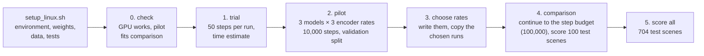

# Running the comparison on a GPU server

This page takes a fresh Linux machine with an NVIDIA GPU, such as a GH200
cloud instance, to a finished comparison report. You type two commands; the
second runs for up to two days and needs no one to step in.

The scripts were written for a GH200 (ARM processor, Hopper GPU) but use
nothing specific to it. They were tried on a Windows machine with an RTX
4090, not on a GH200 itself.

## What runs, in order



| Step | What it does | On an RTX 4090 |
|---|---|---|
| 0 | Checks that PyTorch can use the GPU, and that every pilot run trains exactly like a comparison run apart from the encoder's learning rate; prints what the machine gives the runs | seconds |
| 1 | A 50-step trial of every comparison run with every stage, in `runs/trial`, so that a problem with the machine shows up early; then, once, an estimate of how long the rest takes on this machine (see "Choosing the step budget") | 15 min |
| 2 | The learning-rate pilot: each model with encoder rates 1e-5, 3e-5 and 1e-4 for 10,000 steps, scored on 100 validation scenes | 7.5 h |
| 3 | `scene-recon choose-encoder-rates`: per model, the lowest rate within 0.1 dB PSNR of the best; writes it into `configs/suites/proposal_comparison.yaml` and copies that pilot run into the comparison, which continues it | minutes |
| 4 | The comparison: training from step 10,000 to the step budget (100,000 unless you choose another), scores on the first 100 test scenes, speed | 21.5 h |
| 5 | Scores on all 704 test scenes, 10 views each | 12.5 h |

About 42 hours in all on an RTX 4090, timed in full float32. A GH200
should be faster: `float32_matmul_precision: high` in `configs/base.yaml`
lets its tensor cores compute the matrix products in TensorFloat-32. (On the
RTX 4090 itself, a short test with it rendered 20 to 35% more frames per
second.)

Each step skips what it has already done. If the machine stops, run the
same command again and it carries on.

## Choosing the step budget

Each comparison run trains 100,000 steps (a quarter of the proposal's
400,000), with its learning rate falling tenfold over them. On a faster
machine a larger budget may fit in the time you have. After its trial
(step 1), `run_comparison.sh` times a few training steps and scored views
of every run on this machine, and writes how long the rest would take, for
a few budgets, into `runs/time_estimate.txt`. It prints that file every time
it starts. On the RTX 4090, with the settings of `configs/base.yaml`:

```text
Hours from the start of the pilot until:
  steps per run | pilot done | trained, scored on 100 test scenes | final report
        100,000 |        5.8 |                               21.9 |         33.7
        150,000 |        5.8 |                               29.9 |         41.7
        200,000 |        5.8 |                               37.9 |         49.7
```

To use another budget, stop the script (`Ctrl-c`) and start it again with
the number of steps after the output folder:

```bash
bash scripts/run_comparison.sh runs 200000
```

- **Until when.** The budget can change until the first pilot run saves its
  first checkpoint, 5,000 steps in (`training.checkpoint_every`): about 15
  minutes on the RTX 4090. The pilot trains with the comparison's
  learning-rate schedule, so after that the script refuses another budget.
  A pilot run stopped before its first checkpoint starts again from step 0.
- **What it changes.** `training.num_steps` of every comparison run, and
  `optimization.decay_steps` of every pilot and comparison run. The pilot
  still trains 10,000 steps. The budget is kept in `runs/steps_per_run`, so
  the same command without a number carries on with it after a restart.
- **How far to trust it.** On the RTX 4090 in full float32 it estimated
  40.4 hours for 100,000 steps, against the 42 of the table above. It leaves
  out starting each run and saving checkpoints. On a shared GPU it only
  knows the sharing at the time it ran. Leave some spare time: if the end
  comes too early, the scores on the first 100 test scenes are already
  there (see "Not enough time left" below).
- **Afterwards.** With another budget, set it in the suite files when you
  commit the chosen rates (the script says so when it finishes):
  `training.num_steps` and `optimization.decay_steps` in
  `configs/suites/proposal_comparison.yaml`, and `optimization.decay_steps`
  in `configs/suites/encoder_lr_pilot.yaml`.

The estimate can also be made by hand, for any budgets, once the setup is
done (one line; add `--set` options as the script does):

```bash
scene-recon estimate-time --pilot configs/suites/encoder_lr_pilot.yaml --comparison configs/suites/proposal_comparison.yaml --steps 100000 200000 --first-scenes 100 --set experiment.device=cuda
```

## On a Run:ai cluster

On a Run:ai cluster the machine is a container holding a share of a GPU.
Nothing in the configs has to change for that, but these things matter:

- **Storage.** Clone the repository onto a persistent volume, one that
  outlives the workload (in Run:ai, a data source such as a persistent
  volume claim). The environment `.venv`, the data, the results and the
  pretrained weights the runs download (`weights/`) all live inside the
  repository. Everything else is lost, with every checkpoint on it: the
  container's own disk when the container restarts, and a temporary volume
  (`emptyDir`, mounted, say, at `/workspace`) when Run:ai replaces the
  whole pod. Both scripts warn if the repository is on the container's own
  disk, but they cannot recognise a temporary volume, so check where your
  workload mounts what before you start. If the container image sets
  `HF_HUB_CACHE` or `TORCH_HOME`, those folders must be persistent too:
  step 0 of `run_comparison.sh` prints where the downloaded weights go.
- **Same software after a restart.** Start the workload again with the
  same container image and the volume at the same path: `.venv` uses the
  image's Python, and the pilot refuses to choose between rates scored
  with different software (the report marks each comparison whose
  evaluations were scored with different software).
- **The GPU share.** A share of 0.99 gets 99% of the GPU's memory, about
  95 GB of a 96 GB GH200. On an RTX 4090 the runs needed at most 22 GB
  (PyTorch's peak, while training hiera_nerf); a GH200 should need about
  the same. A share divides the memory, but not necessarily the computing
  time: depending on how the cluster is set up, another workload placed in
  the remaining 1% takes turns on the GPU while both compute. Training then
  slows down, and the training hours and frame rates that the report
  compares between models are off for the runs measured meanwhile. Ask the
  cluster's administrators whether anything else can be scheduled on that
  GPU. Settle the share before you start and keep it until the end: the
  speeds of a comparison are only comparable when every run was measured
  with the same share. If it does change, delete every run's
  `profile.json` so that all are measured again the same way; the
  training hours stay a mix. The copy of the report on the first 100 test
  scenes keeps the speeds measured before the change; its quality scores
  stay valid.
- **Shared memory.** The 4 processes that load batches pass them through
  `/dev/shm`: about 34 MB of it on the GH200, less than the 64 MB a
  container usually gets by default. Training checks this before it starts
  and, if too little is free, stops and says what to do. That leaves little
  to spare, so turn on large shared memory when you submit the workload
  (`--large-shm`, or "Increase shared memory size" in its settings).
- **Processors and memory.** On the RTX 4090 machine, 4 loading processes
  had a batch ready every 6 ms, against 240 to 310 ms per training step,
  so more processors would not train faster there; 8 should be plenty, and
  48 do no harm. The workload's main memory has a limit of its own; leave
  it generous. Step 0 of `run_comparison.sh` prints the GPU memory,
  processors and shared memory the container has.
- **Restarts.** Run:ai may stop a workload, for example one that runs
  beyond its project's quota. Once it runs again, start the same command:
  finished work is kept and training continues from its last checkpoint
  (saved every 5,000 steps).

How long the whole comparison takes on this machine is in
`runs/time_estimate.txt` after step 1 (see "Choosing the step budget"). The
pilot then confirms it: each of its 9 runs takes about 50 minutes on an RTX
4090 (the times on this machine are in `runs/encoder_lr_pilot/suite.log`).
If the first one takes much longer than the estimate said, another workload
may be sharing the GPU, or loading from the volume is slow.

If the container has no `tmux`, start the comparison in the background
instead; its output is in `runs/run_comparison.log`:

```bash
nohup bash scripts/run_comparison.sh runs > /dev/null 2>&1 &
```

## 1. Prepare the machine (about 20 minutes)

```bash
git clone https://github.com/mp2591/3d-scene-reconstruction.git
cd 3d-scene-reconstruction
bash scripts/setup_linux.sh
```

The script creates `.venv`, installs the package, checks that PyTorch sees
the GPU, downloads the Hiera-T weights and ShapeNet-SRN Cars, checks that
the data has all 2,458 / 352 / 704 scenes with every image and pose, and runs
the tests. It stops with an explanation if something is missing, and can be
run again after an interruption: finished steps are skipped. Two things it
may ask for:

- **`python3-venv`**: `sudo apt install python3-venv`, then run it again.
- **No GPU in PyTorch**: the driver is older than the CUDA version of the
  PyTorch it installed. The message gives the command that installs a
  PyTorch for an older CUDA.

If Google Drive refuses the dataset download (it limits how often a file
can be downloaded), copy the dataset from a machine that has it, then run the
script again:

```bash
rsync -a data/srn_cars/ <user>@<server>:3d-scene-reconstruction/data/srn_cars/
```

## 2. Start the comparison

Start it inside `tmux`, so that it keeps running when the SSH connection
drops (without `tmux`, see "On a Run:ai cluster" above):

```bash
tmux new -s comparison
bash scripts/run_comparison.sh runs
```

Leave tmux with `Ctrl-b` then `d`; come back with `tmux attach -t comparison`.
Everything the script prints is also written to `runs/run_comparison.log`.
It first checks that PyTorch can use the GPU, and tells every run to use it,
so no run can fall back to the processor unnoticed. About 15 minutes in, it
prints how long the rest will take; that is the moment to choose another
step budget (see "Choosing the step budget").

## Watching it

- Progress: `tail -f runs/encoder_lr_pilot/suite.log` during the pilot,
  `tail -f runs/proposal_comparison/suite.log` afterwards.
- Training curves: on your own computer, `ssh -L 6006:localhost:6006 <user>@<server>`,
  then on the server `.venv/bin/tensorboard --logdir runs --port 6006`, and
  open http://localhost:6006.
- The GPU: `nvidia-smi`.

## Results

| File | Contents |
|---|---|
| `runs/proposal_comparison/summary.md` | The final report: quality, cost, paired comparisons, figures |
| `runs/proposal_comparison_first_100_test_scenes/summary.md` | The same after step 4, on the first 100 test scenes |
| `runs/encoder_lr_pilot/summary.md` | The pilot's scores on the validation split |
| `runs/encoder_lr_pilot/chosen_rates.json` | The rate chosen for each model and the scores it was chosen from |

The training hours of a comparison run include its first 10,000 steps,
trained in the pilot. The two runs per model that were not chosen are the
pilot's own cost (its `summary.csv`).

Step 3 changes `configs/suites/proposal_comparison.yaml`: commit that change,
so the repository records the rates that were used.

A cloud instance's disk is usually deleted with the instance. Copy the
results to your own computer before shutting it down, for example without
the checkpoints:

```bash
rsync -a --exclude checkpoints <user>@<server>:3d-scene-reconstruction/runs/ gpu-server-runs/
```

## If something goes wrong

- **A test fails during setup.** The tests ran on Windows and on Linux
  with Intel or AMD processors, not on an ARM processor such as the
  GH200's. If a failure is about this machine rather than the code, the
  comparison can still be started: step 1 trains, scores and times every
  run on this machine for a few steps first. The tests are setup's last
  step, so everything else is in place by then.
- **The script stopped with an error.** The last lines name the problem;
  the suite logs (`runs/*/suite.log`) have the details. Fix it and run the
  same command again: finished work is kept.
- **Not enough time left.** Every run has scores on 100 test scenes after
  step 4. Step 5 may be stopped (`Ctrl-c`) and those used instead; they are
  kept in `runs/proposal_comparison_first_100_test_scenes/`. Once that folder
  exists, step 4 is not run again; after changing the comparison (another
  model, another seed), delete it to have step 4 run again.
- **Time to spare at the end.** The step budget is best chosen at the
  start (see "Choosing the step budget"). After step 5, more training steps
  can still be asked for: run steps 4 and 5 again by hand with
  `--set optimization.decay_steps=<budget> training.num_steps=<more steps>`,
  where `<budget>` is the number in `runs/steps_per_run` (see the comments
  in `configs/suites/proposal_comparison.yaml`). Every run continues; the
  learning rate keeps falling past `optimization.decay_steps`. After that,
  `scripts/run_comparison.sh` stops at step 3 on purpose: it would compare
  models trained for different numbers of steps. Keep running steps 4 and 5
  by hand with the same `--set`.
- **Running the steps by hand.** The commands are at the top of
  `configs/suites/encoder_lr_pilot.yaml` and
  `configs/suites/proposal_comparison.yaml`.
